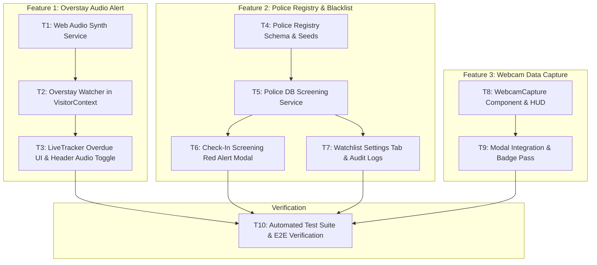

# Sprint 3 — Overstay Audio Alerts, Police Wanted Criminal Integration & Webcam Capture

**Goal:** Deliver real-time automated overstay surveillance with Web Audio synthesizer alerts, local police wanted criminals database integration with instant front-desk screening intercept, and interactive reception webcam visitor photo capture with printable badge rendering.  
**Timebox:** 1 sprint iteration / immediate delivery.  
**Pulled from:** PRODUCT_BACKLOG.md items `OA-601`, `OA-602`, `OA-603`, `OA-604`, `BL-701`, `BL-702`, `BL-703`, `BL-704`, `BL-705`, `WC-801`, `WC-802`, `WC-803`, `WC-804`.

---

## Committed Tasks

| ID | Task | Depends on | Owner | Status |
|---|---|---|---|---|
| **T1** | **Web Audio Alert Engine (`audioAlertService.js`)**: Build zero-dependency Web Audio API synthesizer generating clean chime/alarm frequencies, volume control, mute/unmute state, user-gesture unlock listener, and alert deduplication/cooldown. | — | Fullstack Dev | **DONE** |
| **T2** | **Reactive Overstay Surveillance Heartbeat (`VisitorContext.jsx`)**: Add interval-based duration watcher evaluating `now - checkInTime > expectedDurationMinutes * 60 * 1000`, auto-updating visitor status to `Overdue`, persisting status to database, and triggering audible alert. | T1 | Fullstack Dev | **DONE** |
| **T3** | **Overstay Front-Desk UI & Acknowledge Controls (`LiveTrackerView.jsx`, `Header.jsx`)**: Render pulsing high-contrast overdue warning cards, stay timer exceeding badge, desk audio toggle button in header, and "Acknowledge / Call Escort" dismiss action. | T1, T2 | Frontend Dev | **DONE** |
| **T4** | **Police Wanted Registry Schema & Seed Data (`schema.sql`, `sqliteDb.js`)**: Create `police_wanted_registry` table in Supabase and SQLite with fields for `fullName`, `aliases`, `idType`, `idNumber`, `phone`, `offense`, `warrantNumber`, `severity`, `photoUrl`, `cautionNotes`, and realistic law enforcement seed records. | — | Backend Dev | Ready to implement |
| **T5** | **Police & Blacklist Screening Service (`policeDbService.js`)**: Implement screening engine matching names (fuzzy/normalized tokens), government ID numbers (exact), and phone numbers against local police registry and organization blacklist, with external REST endpoint adapter interface. | T4 | Backend Dev | Ready to implement |
| **T6** | **Real-Time Front-Desk Check-In Screening Intercept (`QuickCheckInModal.jsx`)**: Wire real-time debounced screening into registration inputs; trigger high-priority Red Alert Intercept Modal on match with mugshot comparison, warrant details, and protocol actions (Dispatch Escort, Supervisor Override, Refuse Entry). | T5 | Frontend Dev | Ready to implement |
| **T7** | **Security Watchlist Management & Audit Logging (`SettingsView.jsx`, `VisitorContext.jsx`)**: Add "Police DB & Watchlist" tab in Settings to search police registry, inspect connection status, and verify that all intercept hits log to `audit_logs` with severity `SECURITY_CRITICAL`. | T4, T5, T6 | Frontend Dev | Ready to implement |
| **T8** | **Interactive Webcam Visitor Capture Component (`WebcamCapture.jsx`)**: Build media capture component using `navigator.mediaDevices.getUserMedia` and HTML5 Canvas, featuring live viewfinder, oval face-guide HUD, camera device switcher, freeze/retake controls, and file-upload fallback. | — | Frontend Dev | Ready to implement |
| **T9** | **Webcam Integration & Badge Pass Rendering (`QuickCheckInModal.jsx`, `VisitorPassModal.jsx`)**: Connect `WebcamCapture` into visitor registration flow to save compressed JPEG portrait directly to visitor `avatar` and custom `photo` field, rendering on printable badge pass. | T8 | Frontend Dev | Ready to implement |
| **T10** | **Automated E2E Verification & Adversarial Stress Tests (`test/sprint3-verification-tests.js`)**: Implement test suite validating duration calculation overstay transitions, sound engine state safety, police screening fuzzy match boundaries, and camera fallback invariants. | T1–T9 | QA / Test Eng | Ready to implement |

---

## Technical Dependencies & Sequence Graph

---

## Definition of Done for Sprint 3

1. **Overstay Audio Alert**:
   - The system checks all on-premises visitors every 10–15 seconds against their registered `expectedDurationMinutes`.
   - Any visitor who exceeds their allowed stay automatically transitions to `'Overdue'` status in both application state and database.
   - An audible two-tone chime synthesizes cleanly via Web Audio API without requiring external audio assets.
   - Front-desk officer can mute/unmute audio alerts from the header, and individual overstay alerts can be acknowledged to prevent continuous repetitive chimes.
   - Overdue count and visual alerts update across Live Tracker, Department View, and Analytics.

2. **Police Wanted Criminal & Blacklist Screening**:
   - `police_wanted_registry` table is provisioned with wanted criminal records, active arrest warrants, and caution notes.
   - Front-desk check-in screens visitor inputs in real-time (debounced ~300ms) across name, ID number, and phone number.
   - Any match triggers a high-visibility Red Alert Intercept Modal displaying offender photo, warrant number, offense, and issuing agency.
   - Actions provided: Dispatch Security Escort, Supervisor Passphrase Override, or Refuse Entry.
   - All screening hits and supervisor overrides are permanently logged into `audit_logs`.

3. **Webcam Visitor Photo Capture**:
   - Front-desk officer can activate the webcam with a single click in the registration modal.
   - Viewfinder displays live stream with an oval face-guide reticle to ensure proper portrait framing.
   - Instant snapshot capture freezes the image and converts it to an optimized base64 JPEG data URL.
   - Captured photo persists as the visitor's avatar and prints cleanly on the QR visitor badge pass.
   - Clean stream track teardown on close, with seamless file upload fallback if webcam access is denied.

4. **Code Quality & Build Integrity**:
   - `npm test` and new Sprint 3 automated test suite pass with 100% success rate.
   - `npm run build` compiles cleanly with zero JSX/JS errors.
